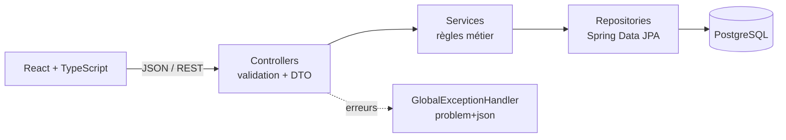
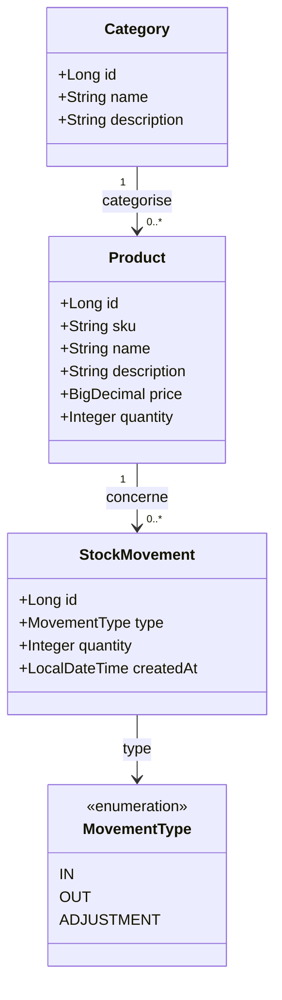

# StockPilot

[](https://github.com/evann-pommier/StockPilot/actions/workflows/ci.yml)


Application web de **gestion de stock** : catalogue de produits, catégories, et suivi de chaque entrée/sortie dans un historique des mouvements. API REST Spring Boot + interface React/TypeScript.

<!-- TODO : ajouter une capture d'écran dans docs/screenshot.png puis décommenter la ligne suivante

-->

## Fonctionnalités

- **Produits** : création, modification, suppression, recherche (insensible à la casse et aux accents), filtres par catégorie et par état du stock.
- **Catégories** : création et gestion, avec protection contre la suppression d'une catégorie non vide.
- **Mouvements de stock** : entrées et sorties horodatées ; une sortie supérieure au stock disponible est refusée ; l'annulation d'un mouvement recalcule le stock.
- **Tableau de bord** : références, unités en stock, alertes de stock faible (seuil de 5 unités).
- **API robuste** : validation des entrées, erreurs normalisées (RFC 9457) avec les bons codes HTTP.

## Démarrage rapide

Prérequis : Docker.

```bash
docker compose up --build
```

L'application (interface + API) est servie sur <http://localhost:8080>, avec un jeu de données de démonstration (profil `demo`). Pour démarrer sans données d'exemple : `SPRING_PROFILES_ACTIVE=default docker compose up --build`.

## Développement local

Prérequis : JDK 21, Node 22, Docker (pour PostgreSQL).

```bash
docker compose up -d db                              # PostgreSQL seul
SPRING_PROFILES_ACTIVE=demo ./mvnw spring-boot:run   # API sur :8080 (sous Windows : .\mvnw.cmd ...)
cd frontend && npm install && npm run dev            # UI sur :5173, /api est proxifié vers :8080
```

La connexion à la base se configure par variables d'environnement (`DB_URL`, `DB_USERNAME`, `DB_PASSWORD`) ; les valeurs par défaut correspondent au `docker-compose.yml` de développement. Voir [`.env.example`](.env.example). Aucun secret n'est versionné.

## Architecture



| Couche | Responsabilité |
|---|---|
| `controller` | Routes HTTP, validation (`@Valid`), conversion entité ⇄ DTO |
| `dto` | Contrats d'API (`record`), découplés du modèle de persistance |
| `service` | Règles métier et transactions (interface + implémentation) |
| `repository` | Accès aux données, requêtes dérivées, `@EntityGraph` contre le N+1 |
| `exception` | Exceptions métier typées et traduction centralisée en réponses HTTP |
| `config` | Données de démonstration (profil `demo`) |

### Modèle de données



## API

| Méthode | Route | Description |
|---|---|---|
| `GET` | `/api/products?search=&categoryId=` | Liste, avec recherche par nom ou filtre par catégorie |
| `GET` | `/api/products/low-stock?threshold=5` | Produits en stock faible |
| `GET` `POST` | `/api/products` · `/api/products/{id}` | Consulter / créer |
| `PUT` `DELETE` | `/api/products/{id}` | Modifier / supprimer (refusé si historique de stock) |
| `GET` `POST` | `/api/categories` | Lister / créer |
| `GET` `PUT` `DELETE` | `/api/categories/{id}` | Consulter / modifier / supprimer (refusé si non vide) |
| `GET` | `/api/movements` | Historique, du plus récent au plus ancien |
| `GET` | `/api/movements/product/{id}` · `/type/{type}` | Historique filtré |
| `POST` | `/api/movements` | Enregistrer une entrée ou une sortie : `{ "productId", "type", "quantity" }` |
| `DELETE` | `/api/movements/{id}` | Annuler un mouvement (le stock est recalculé) |

Les erreurs suivent la [RFC 9457](https://www.rfc-editor.org/rfc/rfc9457) :

```json
{ "title": "Règle métier non respectée", "status": 409,
  "detail": "Stock insuffisant pour effectuer cette sortie." }
```

| Code | Cas |
|---|---|
| `400` | Corps invalide (champs détaillés dans `errors`), paramètre incorrect |
| `404` | Ressource introuvable |
| `409` | SKU ou nom en double, règle métier violée (stock insuffisant, suppression interdite) |

## Choix techniques

- **Le stock ne se modifie que par mouvements.** `PUT /api/products/{id}` ignore la quantité : chaque variation est tracée et auditable, et le stock ne peut jamais devenir négatif.
- **DTO plutôt qu'entités exposées.** Le contrat d'API est explicite et stable ; il n'y a pas de sérialisation accidentelle de relations JPA.
- **Exceptions typées** (`ResourceNotFoundException`, `DuplicateResourceException`, `BusinessRuleException`) traduites en un seul endroit, sans `try/catch` dans les contrôleurs.
- **Logique frontend pure et testée** (`lib/`) séparée des composants ; un client HTTP unique convertit les erreurs de l'API en messages affichables.

## Tests

```bash
./mvnw verify                  # tests backend + rapport et seuil JaCoCo
cd frontend && npm test        # tests frontend
```

| Périmètre | Approche |
|---|---|
| Services | Tests unitaires Mockito, sans base de données |
| Contrôleurs | `MockMvc` autonome : codes HTTP, validation, format des erreurs |
| Repositories | Tests d'intégration `@DataJpaTest` sur H2 |
| Frontend | Vitest + Testing Library : filtres, formulaires, client HTTP, historique |

`mvn verify` **échoue si la couverture de lignes passe sous 80 %** (hors classe de démarrage et données de démo). Le rapport HTML est généré dans `target/site/jacoco/index.html`. La CI GitHub Actions exécute le backend et le frontend à chaque push.

## Pistes d'amélioration

- Pagination et filtrage côté serveur (les listes sont aujourd'hui chargées en entier).
- Migrations Flyway à la place de `ddl-auto=update`.
- Verrouillage optimiste (`@Version`) pour les mouvements concurrents sur un même produit.
- Authentification et rôles (Spring Security).
- Tests d'intégration sur PostgreSQL réel (Testcontainers).
- Gestion des ajustements d'inventaire (`ADJUSTMENT`), déjà présent dans le modèle.

## Licence

[MIT](LICENSE)
