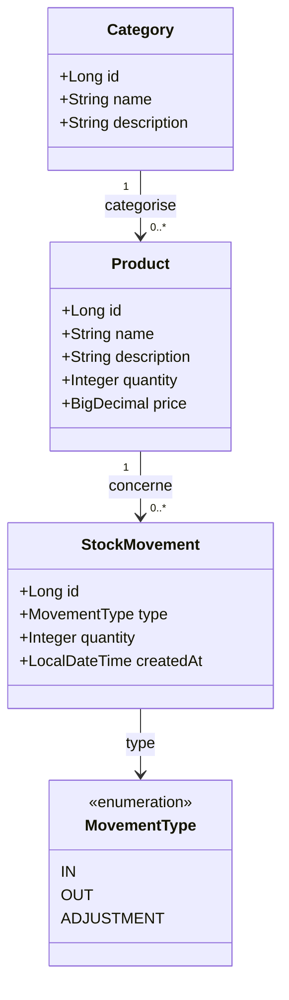

# StockPilot

## 1. Présentation du projet

**StockPilot** est une application web de gestion de stock développée dans le cadre d'un projet full-stack Java. Elle a pour objectif de faciliter la gestion des produits, le suivi des quantités disponibles et la consultation des informations liées au stock.

Le projet met l'accent sur la qualité du code, la séparation des responsabilités, la maintenabilité et la testabilité. Son architecture est conçue pour permettre l'ajout progressif de nouvelles fonctionnalités.

Les fonctionnalités prévues comprennent :
- La gestion des produits et des catégories.
- Le suivi des quantités en stock.
- La recherche et le filtrage des produits.
- La gestion des mouvements de stock.
- Un tableau de bord avec des indicateurs clés.
- Une interface web moderne et responsive.

## 2. Stack technique

| Technologie | Rôle |
|---|---|
| Java 26 | Langage backend |
| Spring Boot 4.1.1 | Framework backend |
| Spring Web MVC | Développement de l'API REST |
| Spring Data JPA / Hibernate | Persistance des données |
| Jakarta Validation | Validation des données |
| PostgreSQL | Base de données relationnelle |
| Maven Wrapper | Gestion des dépendances et compilation |
| JUnit | Tests automatisés |
| JaCoCo | Mesure de la couverture des tests |
| React + TypeScript | Interface frontend prévue |
| OpenAPI / Swagger | Documentation de l'API prévue |

Les outils JaCoCo, React et OpenAPI seront intégrés au fur et à mesure du développement.

## 3. Guide d'installation

### Prérequis

- JDK compatible avec Java 26.
- PostgreSQL installé et démarré.
- IntelliJ IDEA ou un IDE Java équivalent.
- Git.

### Récupération du projet

Cloner le dépôt Git :

```bash
git clone <URL_DU_DEPOT>
cd stockpilot
```

### Configuration de PostgreSQL

Créer une base de données nommée `stockpilot`.

Configurer le fichier `src/main/resources/application.properties` :

```properties
spring.datasource.url=jdbc:postgresql://localhost:5432/stockpilot
spring.datasource.username=${DB_USERNAME}
spring.datasource.password=${DB_PASSWORD}

spring.jpa.hibernate.ddl-auto=update
```

Définir les variables d'environnement `DB_USERNAME` et `DB_PASSWORD` avec les identifiants PostgreSQL appropriés.

Ne jamais versionner les mots de passe ou autres secrets.

### Compilation et lancement

Sous Windows, depuis la racine du projet :

```powershell
.\mvnw.cmd validate
.\mvnw.cmd test
.\mvnw.cmd spring-boot:run
```

Lorsque l'application démarre correctement, le backend est accessible à l'adresse :

`http://localhost:8080`

## 4. Diagramme de classes

Le diagramme ci-dessous représente le modèle métier cible. Il sera actualisé à mesure que les entités et leurs relations seront implémentées.



Les entités `Category` et `StockMovement` ainsi que leurs relations sont prévues et ne sont pas nécessairement déjà implémentées.

## 5. Stratégie de test

L'objectif est d'obtenir une couverture de code **JaCoCo supérieure ou égale à 80 %**, avec un contrôle automatisé lors du build Maven.

### Tests unitaires

Tester les services métier indépendamment de la base de données, notamment :
- Les règles de gestion des produits.
- Les validations métier.
- Les cas limites et les erreurs.
- Les calculs et les opérations sur les quantités.

### Tests des contrôleurs

Vérifier :
- Les codes de réponse HTTP.
- La validation des requêtes.
- La structure des réponses JSON.
- La gestion des erreurs.

### Tests d'intégration

Tester les interactions entre les composants Spring, les repositories et PostgreSQL, notamment la persistance et la récupération des données.

### Couverture et automatisation

JaCoCo sera configuré pour générer un rapport de couverture et imposer un seuil minimal lors du build.

Commandes prévues :

```powershell
.\mvnw.cmd test
.\mvnw.cmd verify
```

Le rapport HTML sera disponible à l'emplacement suivant après génération :

`target/site/jacoco/index.html`

La couverture sera évaluée sur les lignes et les branches afin de mesurer la qualité des tests au-delà du simple nombre de tests écrits.